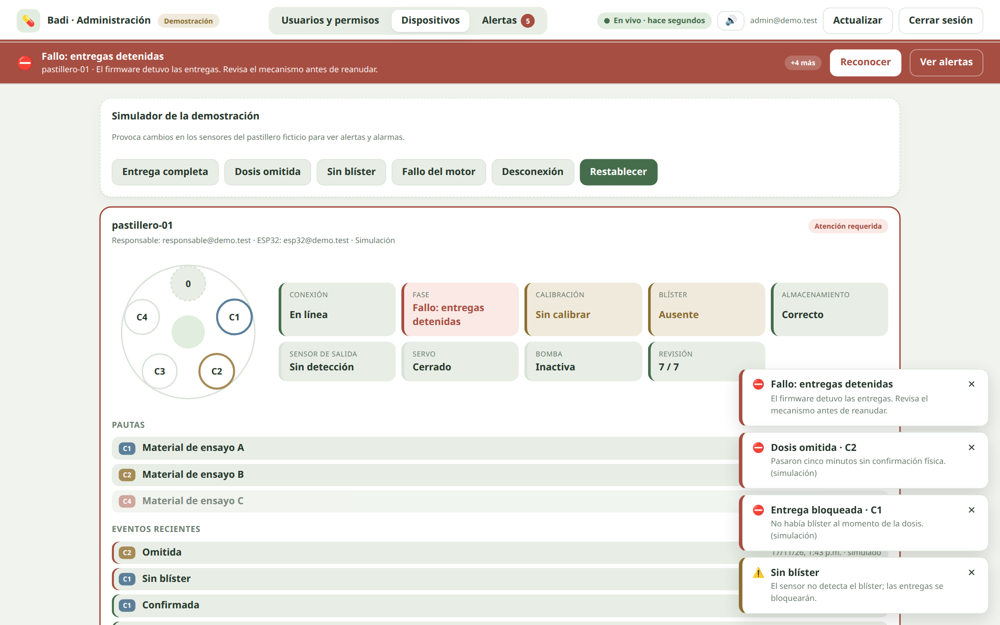
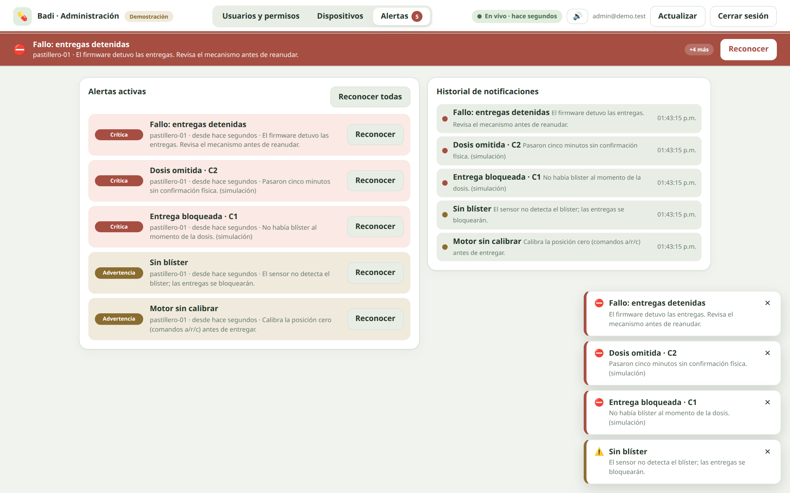
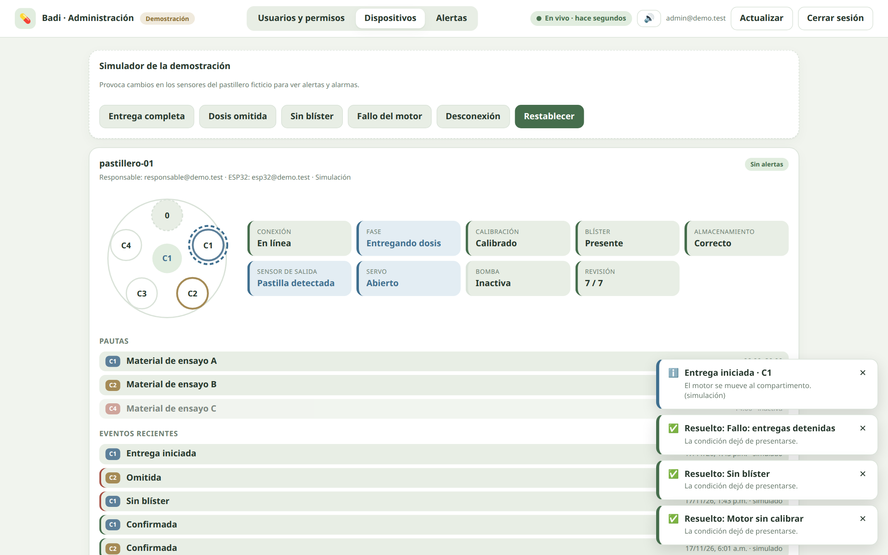
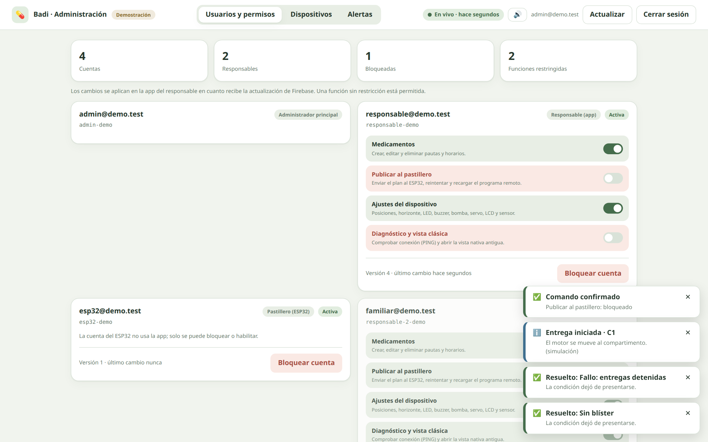
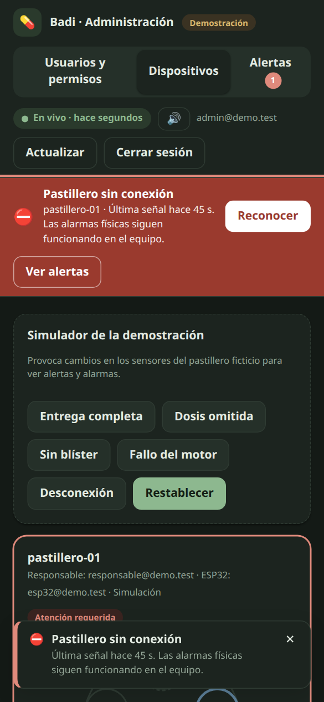

# Dashboard administrativo — Pastillero Badi

Panel web para **el administrador**. Los responsables siguen usando la app Android; este panel decide qué pueden hacer en ella.

**Demo en vivo:** https://pastillero-badi-dashboard.vercel.app (datos ficticios; usa el simulador de la pestaña *Dispositivos* para provocar las alarmas).

- **Usuarios y permisos:** lista las cuentas, bloquea/habilita una cuenta completa y activa o desactiva funcionalidades de la app por responsable.
- **Dispositivos:** sensores y estado V2 de cada pastillero en vivo, carrusel de cinco posiciones (0 = retorno vacío, C1–C4 útiles), pautas publicadas y eventos recientes. Solo lectura: el panel no envía comandos al hardware.
- **Alertas:** alarmas visuales y sonoras ante cambios críticos de los sensores y confirmación de cada comando.

## Monitoreo en vivo, alertas y alarmas

El panel consulta el backend cada 5 s (indicador **En vivo**) y evalúa el estado V2 que publica el ESP32 (`devices/<id>/v2/state` y `events`).

| Origen | Condición | Nivel |
|---|---|---|
| Conexión | Sin estado nuevo en más de 30 s | Crítica |
| Fase | 7 = fallo, entregas detenidas · 5 = requiere revisión física | Crítica |
| Almacenamiento NVS | `storageHealthy=false` (el equipo deja de dispensar) | Crítica |
| Eventos | `MISSED` dosis omitida · `BLOCKED` entrega bloqueada · `RECOVERY` reinicio durante entrega | Crítica |
| Sensor de blíster | `blisterPresent=false` | Advertencia |
| Calibración | `calibrated=false` | Advertencia |
| Sensor de salida | evento `NO_EXIT` | Advertencia |
| Fase 4 / revisión | Esperando botón · plan publicado aún no aplicado | Aviso |
| Eventos / comandos | `STARTED`, `CONFIRMED`; permisos aplicados por el backend | Confirmación |

- **Indicadores reactivos:** tarjetas de sensores coloreadas por estado (fase, conexión, calibración, blíster, almacenamiento, sensor de salida, servo, bomba, revisión), carrusel 0 + C1–C4 con anillo animado en el compartimento en entrega y tarjeta del dispositivo con borde pulsante ante una crítica.
- **Mensajes y alertas dinámicas:** notificaciones apiladas al aparecer o resolverse cada condición y con cada evento nuevo; pestaña **Alertas** con activas, reconocimiento individual o total e historial.
- **Alarmas:** banner rojo intermitente fijo bajo la barra superior, contador animado, título de la pestaña parpadeante y sirena (Web Audio) que se repite cada 3 s mientras haya críticas sin reconocer. Advertencias con doble pitido y confirmaciones con tono ascendente. Botón 🔊/🔇 para silenciar; se respeta `prefers-reduced-motion`.
- **Confirmación de comandos:** cada cambio de permisos o bloqueo muestra *Comando confirmado* (o *rechazado* con el motivo) y suena.

En la demostración, la pestaña **Dispositivos** incluye un simulador (entrega completa, dosis omitida, sin blíster, fallo del motor, desconexión, restablecer) para provocar cada caso.

| | |
|---|---|
|  |  |
| Alarma crítica: fallo del motor, dosis omitida y sin blíster | Alertas activas con reconocimiento e historial |
|  |  |
| Entrega en curso: fase, servo y sensor de salida en vivo | Confirmación de comando al bloquear una función |



## Permisos por funcionalidad

| Funcionalidad | Qué bloquea en la app |
|---|---|
| Medicamentos | Crear, editar y eliminar pautas |
| Publicar al pastillero | Publicar el plan, reintentar, recargar/rebasar el programa remoto |
| Ajustes del dispositivo | Guardar posiciones, horizonte y periféricos |
| Diagnóstico y vista clásica | Comprobar conexión (PING) y abrir la vista nativa |

Detalles del modelo de permisos y de la API: [`docs/ADMINISTRACION_WEB.md`](../docs/ADMINISTRACION_WEB.md).

## Demostración (sin Firebase)

```sh
cd dashboard-web
npm ci
npm run dev
```

Abrir http://127.0.0.1:4174. Sin `.env.local` el panel usa datos ficticios en memoria; no contacta Firebase ni el backend.

## Uso real

1. Completar los pasos de *Activación posterior* en `docs/ADMINISTRACION_WEB.md` (cuenta administrativa dedicada, `private/dashboard-admin.local.json`, ADC y `bootstrap-admin.mjs`).
2. Copiar `.env.example` a `.env.local` y llenar la configuración **web pública** de la app registrada en el proyecto `pastillerobadi` (Firebase Console → Configuración del proyecto → Tus apps → Web). Nunca colocar aquí una cuenta de servicio.
3. Compilar y servir desde el backend (mismo origen, sin CORS):

   ```sh
   cd dashboard-web && npm ci && npm run build
   cd ../admin-backend && npm ci && npm start
   ```

   Abrir http://127.0.0.1:8787 con `"origin": "http://127.0.0.1:8787"` en la configuración privada.

Para desarrollar contra el backend real, `npm run dev` reenvía `/api` a `127.0.0.1:8787`; en ese caso `origin` debe ser `http://127.0.0.1:4174`.

## Pruebas

```sh
npm test        # Vitest: reglas de alertas, alarmas, permisos y cliente HTTP
npm run build   # verifica TypeScript y compila a dist/
```
