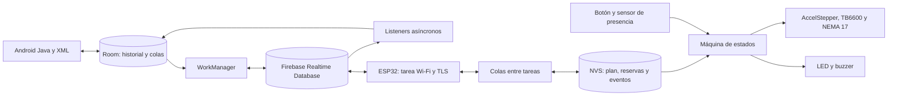

# Arquitectura Badi

El contrato de datos y permisos se encuentra en `CONTRATO_FIREBASE.md`. Android conserva interfaz XML, Java, Room y los historiales existentes. La base `pastillero.db` migra de 1→2→3 sin operaciones destructivas. Los accesos a Room se ejecutan fuera del hilo de interfaz; las solicitudes de red son asíncronas y WorkManager reintenta con conectividad disponible. Los listeners se retiran al cerrar la pantalla.

Los horarios son ocurrencias concretas con fecha UTC en milisegundos. Se permiten hasta 24 por plan, separadas diez minutos. Cada dosis tiene UUID estable. Android muestra hora programada, hora registrada y diferencia. Los eventos simulados no se cuentan como adherencia.

El ESP32 guarda `STARTED` y reserva el identificador antes de mover. Conserva hasta 64 eventos pendientes y 256 identificadores consumidos. Si falla el almacenamiento o se llena la reserva, deja de dispensar. Las respuestas de comandos se persisten antes del envío y se eliminan de la cola solo con acuse. Un reinicio durante entrega produce `RECOVERY` y requiere revisión/calibración; no repite automáticamente la dosis.

La mecánica original permanece en `original/`: PUL 25, DIR 26, inversión de pines, velocidad máxima 1000 y aceleración 500. Comandos `a` (+10), `r` (−10), `c` (cero), `s` (1→0, 2→0, 3→0). Se conservan dos segundos en salida y quince después del regreso. Cuatro posiciones, 3200 pasos/vuelta y 800 por compartimento por defecto; cero es la posición de retorno.

`millis()` controla los estados; `motor.run()` se ejecuta continuamente. Wi-Fi y HTTPS corren en otra tarea FreeRTOS; las escrituras NVS y aplicación de planes ocurren con el motor estacionario. Reconexión Wi-Fi con espera de 5 a 60 segundos y renovación del token de sesión. TLS valida certificados; no usa `setInsecure`. Las respuestas HTTP están limitadas a 48 000 bytes, incluidas respuestas sin longitud conocida.

La omisión se registra a los cinco minutos de la hora programada. Se exige una nueva pulsación física después del retorno a cero: un botón mantenido previamente no confirma. El sensor verifica presencia, no ingestión. El motor opera en lazo abierto; no se demuestra detección de atasco o pérdida de pasos.

Las alertas físicas son autónomas. Android notifica los eventos recibidos con la pantalla activa y conserva el historial offline; no se garantiza aviso móvil puntual con la aplicación cerrada. FCM, React y pruebas físicas quedan fuera de esta entrega.

El modelo de control y el validador de comandos están en el único PastilleroESP32.ino. Las pruebas lo incluyen directamente con PASTILLERO_HOST_TEST; no utilizan cabeceras propias. La unificación conserva el contrato JSON y Room4. Consultar UNIFICACION_FIRMWARE.md y las guías por línea.

Revisión del 22 de octubre de 2026: la configuración y los certificados están dentro del .ino; los datos locales se materializan mediante generate_private_firmware.py. La carpeta del sketch contiene solo .ino y partitions.csv. Referencia elegida, procedimiento privado y evidencia: COMPARACION_CRUDSQLITE1.md y UNIFICACION_FIRMWARE.md.
