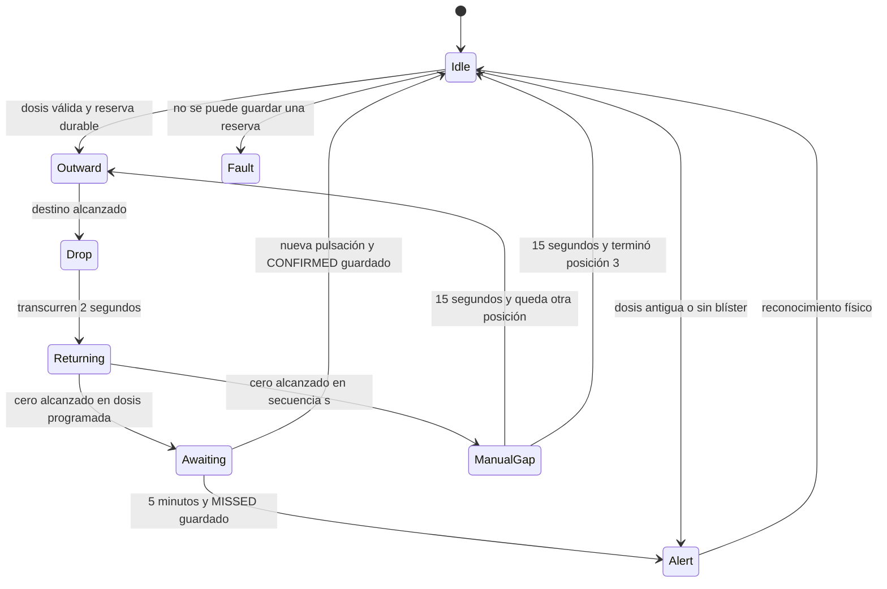

# Guía de defensa oral — ISC0633

## 1. Cómo usar estas seis guías

Empieza por esta guía para comprender el recorrido completo. Continúa con `GUIA_ROOM_SQLITE.md` y `GUIA_FIREBASE.md`. Después estudia `GUIA_ARDUINO_LINEA_POR_LINEA.md` y `GUIA_ANDROID_LINEA_POR_LINEA.md` con el editor abierto: cada tabla identifica la línea final, su operación y sus componentes. Usa `GUIA_CONEXIONES_HARDWARE.md` para explicar los pines y lo que requiere verificación eléctrica posterior.

Los comentarios del código siguen el estilo de lectura por responsabilidades de CRUDSQLITE1: componentes, configuración, inserción/consulta, callbacks y liberación de recursos. No se concentró Android en una clase gigante. El firmware sí reúne el modelo y las funciones en un `.ino`; dos cabeceras mínimas permiten que las pruebas existentes incluyan el mismo modelo sin Arduino.

No memorices una frase para todos los archivos. Para cada método responde: **qué recibe, qué comprueba, qué cambia, qué devuelve y qué ocurre si falla**. Para una línea con varios operadores, señala sus partes en el orden en que se evalúan.

## Conceptos básicos: las quince preguntas de la defensa

### ¿Qué es ESP32?

Es un microcontrolador programable con conectividad Wi-Fi: ejecuta el firmware incluso cuando Android está cerrado. En este proyecto atiende sensores, calcula destinos, conserva reservas en NVS y consulta Firebase. No es el motor: manda señales al controlador TB6600, que entrega la potencia a las bobinas. Abre `firmware/PastilleroESP32/PastilleroESP32.ino` y localiza `setup()`, `loop()` y `tareaFirebase()`.

### ¿Qué es Firebase Realtime Database?

Es una base alojada en un servidor que conserva un árbol JSON y permite escuchar cambios. Aquí comparte horarios, estado, solicitudes, respuestas y eventos entre cuentas autorizadas. Authentication identifica la cuenta y las reglas autorizan cada ruta. Una escritura local del SDK todavía puede estar pendiente: para confirmar sincronización se necesita el acuse del servidor.

### ¿Qué es una base de datos NoSQL?

Es una familia de bases cuyo modelo no se limita a tablas relacionales consultadas con SQL. Realtime Database usa un árbol de claves y valores: por ejemplo, `devices/pastillero-01/v2/program/doses/ID/compartment`. NoSQL no significa «sin estructura» ni «sin reglas»: este proyecto exige campos, tipos, revisiones e identidades estables. En `GUIA_FIREBASE.md` puedes recorrer el árbol y sus permisos.

### ¿Qué es SQLite?

Es un motor de base de datos relacional que Android puede utilizar dentro del teléfono, sin necesitar un servidor externo. Almacena tablas y permite consultas SQL como `SELECT * FROM dose_events WHERE scope=:scope`. En esta app la base se llama `pastillero.db` y conserva eventos, borradores y solicitudes. Cerrar la pantalla no elimina ese archivo.

### ¿Para qué sirve Room?

Room es la biblioteca que organiza el acceso a SQLite mediante entidades, DAOs y una clase de base de datos. Una entidad describe una tabla; el DAO declara operaciones; Room comprueba consultas y genera su implementación al compilar. Reduce errores de mapeo, pero todavía exige diseñar claves, migraciones y trabajo fuera del hilo principal. `PastilleroDatabase` permanece en versión 3.

### ¿Qué diferencia existe entre Firebase y Room?

Firebase conserva la copia compartida a la que llegan los clientes autorizados. Room conserva la copia local que Android puede consultar y editar aunque no tenga Internet. Room no publica automáticamente sus tablas en Firebase: `Repository`, `SyncWorker` y `CommandWorker` coordinan ese intercambio. La caché offline del SDK Firebase y el historial Room son almacenes distintos.

### ¿Qué es un sistema distribuido?

Es un sistema cuyas partes ejecutan trabajo en equipos diferentes y se comunican mediante una red. Aquí Android, el servicio Firebase y el ESP32 tienen memoria y tiempos de ejecución propios; pueden desconectarse por separado. Por eso una solicitud enviada no equivale a una solicitud ejecutada. IDs, revisiones, colas y acuses permiten reconocer lo que ocurrió sin repetir una entrega.

### ¿Cómo funciona el modo offline?

Android lee su historial Room y guarda un borrador o una solicitud antes de intentar publicarlos. WorkManager reintenta cuando hay conexión; conserva identidad y contenido del pendiente. El ESP32 conserva en NVS el plan aceptado, las reservas y los eventos aún no subidos. La ejecución autónoma exige que el dispositivo siga encendido, calibrado y con un reloj válido; tras un reinicio sin sincronización no se asume una hora correcta. No se garantiza aviso remoto mientras no haya red.

### ¿Qué hace millis()?

Devuelve milisegundos desde el arranque y permite medir intervalos cortos sin detener el programa. Por ejemplo, `uint32_t(ms-since) >= 2000` comprueba si terminó la espera de entrega mientras `loop()` sigue atendiendo otras tareas. La resta unsigned tolera el desbordamiento del contador para estos intervalos. No proporciona fecha de calendario: los horarios usan milisegundos Unix UTC, obtenidos del reloj sincronizado.

### ¿Qué es un motor paso a paso?

Es un motor que avanza por incrementos al excitar sus bobinas en secuencia. NEMA 17 identifica un tamaño de montaje, no fija por sí solo la corriente ni los pasos por vuelta. Con la configuración de este proyecto se esperan 3200 pulsos por vuelta y 800 por cada una de las cuatro posiciones. AccelStepper calcula el avance; sin encoder, el programa no puede demostrar que no hubo pérdida mecánica de pasos.

### ¿Cómo funciona el TB6600?

Es el controlador que regula la corriente de las bobinas y convierte señales de paso/dirección en movimiento. El ESP32 usa GPIO 25 para PUL y 26 para DIR mediante una interfaz eléctrica compatible con el módulo real. La fuente del motor no se obtiene de un GPIO. Microstepping, corriente, polaridad y niveles deben comprobarse con el manual del módulo concreto antes de las pruebas físicas; `GUIA_CONEXIONES_HARDWARE.md` separa esos pendientes.

### ¿Cómo se sincroniza Android con ESP32?

Android guarda el borrador en Room y un Worker publica `plan` con revisión y token. El ESP32 consulta Firebase, valida el modo y el contenido, persiste el plan y publica `appliedRevision`. Las solicitudes `PING` y `APPLY_PLAN` van en `commandRequests`; sus respuestas van en `commandResults`. Los eventos físicos o simulados van en `events`, y un listener Android los inserta en Room sin duplicar su clave.

### ¿Qué sucede si se pierde Wi-Fi?

La tarea de red ESP32 reintenta con intervalos crecientes hasta sesenta segundos; el control usa el plan ya aceptado cuando sus condiciones locales siguen siendo válidas. Los eventos quedan en NVS hasta obtener acuse y no se borra la reserva de dosis por perder Internet. Android conserva Room y reanuda sus colas con conexión. Las pruebas del SDK `goOffline()/goOnline()` no demuestran todavía la reconexión del radio del ESP32: esa integración física sigue pendiente.

### ¿Cómo se detecta una dosis omitida?

El controlador compara la hora UTC actual con `scheduledAt`. Si pasan 300000 ms sin confirmación, registra `MISSED` y entra en alerta; el plazo empieza en la hora programada. Una dosis que ya llega demasiado tarde tampoco provoca una entrega nueva. El botón puede reconocer la alerta para salir de ella, pero no convierte el evento omitido en `CONFIRMED` ni demuestra ingestión.

### ¿Cómo se evita repetir una dispensación?

Antes de iniciar la entrega se persisten `STARTED`, la dosis activa y su ID en `done`. El selector descarta IDs reservados aunque el plan llegue de nuevo; al reiniciar, una entrega interrumpida produce `RECOVERY` y revisión. Firebase conserva claves y contenido inmutables; Room usa claves compuestas e inserción `IGNORE`. Si no se puede guardar una reserva, el firmware falla cerrado. Estas medidas evitan el reinicio automático de una dosis; no sustituyen la validación mecánica pendiente.

## Flujo completo para explicar con una dosis de ejemplo

Ejemplo didáctico: el responsable elige una hora futura y el compartimento 2. No se importa ni ejecuta este ejemplo durante el estudio.

1. `MainActivity` recibe la fecha/hora local y convierte la selección a milisegundos Unix. El índice 1 del Spinner se convierte en compartimento 2 mediante `+1`.
2. `Repository.add()` crea un ID de dosis y valida rango de fecha, máximo de 24 horarios y separación mínima de diez minutos. `mutate()` guarda JSON, token nuevo y `dirty=true` en Room usando su ejecutor de disco.
3. `SyncWorker` exige conectividad y la misma cuenta activa. Su transacción compara `baseRevision` con la revisión de Firebase: publica la siguiente o informa conflicto. Un reintento del mismo token reconoce una publicación anterior.
4. Tras el acuse, el DAO limpia `dirty` únicamente para el token enviado. Se guarda una solicitud `APPLY_PLAN` con ID estable; «publicado» todavía no significa «aplicado por el dispositivo».
5. La tarea de red del ESP32 autentica su cuenta limitada y consulta el plan. Envía el texto por una cola; el controlador detenido valida todas las dosis y guarda el plan en NVS antes de adoptarlo. La telemetría indica la revisión aplicada.
6. Al llegar la fecha, con reloj válido, calibración, presencia y almacenamiento disponibles, `Controller.tick()` selecciona esa dosis. Primero persiste `STARTED` y su reserva. Solo entonces solicita el destino `2*800=1600` pasos.
7. En simulación el adaptador solo cambia una posición en RAM. En la futura prueba física autorizada, `motor.run()` atendería los pasos hacia el destino, esperaría dos segundos sin bloqueo y regresaría al cero calibrado. Las verificaciones actuales no accionan ese motor.
8. Al regresar, una liberación y pulsación nueva del botón registra `CONFIRMED` con hora real. Si transcurren cinco minutos desde la programación sin confirmar, se registra `MISSED`. El sensor de presencia no confirma por sí mismo la toma.
9. El evento queda durable en NVS. La red lo publica en su clave estable y solo retira el pendiente con acuse; `done` sigue impidiendo repetir la dosis.
10. El listener Android inserta el evento en Room. Su clave compuesta evita otra fila al reconectar; LiveData actualiza historial, diferencia entre fechas y, cuando corresponda, aviso local. Si no hay Internet, esta recepción espera; el historial ya guardado sigue disponible.

Puedes resumirlo de memoria como **editar → guardar local → publicar con revisión → aceptar en NVS → reservar ID → entregar → confirmar/alertar → publicar evento → conservar historial**. En cada flecha indica quién ejecuta, dónde persiste y qué ocurre si falta el acuse.

## 2. Presentación sugerida de diez a doce minutos

### Minuto 0–1: problema y objetivo

«Pastillero Badi es un prototipo programable con Android nativo, ESP32 y una base compartida. Permite registrar horarios por compartimento, conservar historial sin Internet y distinguir una entrega iniciada de una confirmación física. El trabajo de la materia se refleja en Room/SQLite, Firebase, consultas, sincronización y permisos.»

«La posición cero es ciega/de retorno. Hay cuatro posiciones totales y tres compartimentos de dosis. Las pruebas actuales no usan medicamentos ni accionan el mecanismo.»

### Minuto 1–3: arquitectura y bases de datos

Abre `MainActivity.java`, `Repository.java`, `PastilleroDao.java` y las tres entidades. Explica cómo XML crea una vista, R.id permite encontrarla, un listener del botón solicita editar el borrador y un ejecutor hace el trabajo Room.

«SQLite conserva tablas en el teléfono. Room genera su acceso a partir de entidades/DAO. Firebase conserva el árbol compartido. NVS conserva la reserva y pendientes del ESP32. La sincronización usa UUID, revisiones y acuses; no borra y vuelve a descargar todo.»

Muestra las claves `(scope,eventId)` y `(scope,commandId)`. Explica por qué el historial de otra cuenta no se mezcla y por qué una retransmisión no duplica registros. Muestra una consulta WHERE, ORDER BY y LIMIT, explicando cada cláusula con `GUIA_ROOM_SQLITE.md`.

### Minuto 3–5: horario de extremo a extremo

«La persona elige fecha, hora y compartimento. El borrador queda en Room aunque falte Internet. Un Worker exige conectividad y compara la revisión remota. El acuse limpia dirty solo si sigue coincidiendo el token de la edición. El dispositivo acepta y persiste el plan, y comunica appliedRevision.»

Señala `SyncWorker.doTransaction()` y la comparación de token/revisión. Explica el caso de dos editores: uno gana y el otro ve conflicto; no se sustituye un plan reciente con otro antiguo. Aclara que WorkManager envía datos; el reloj que ejecuta la dosis es el del firmware, no un temporizador de la pantalla.

### Minuto 5–7: firmware y no bloqueo

Abre `PastilleroESP32.ino`. Primero señala Dose/State/Controller; luego los adaptadores, persistencia, tarea de red y finalmente setup/loop.

«setup configura una vez y restaura el estado. loop llama run, procesa mensajes cuando está detenido, revisa calibración, avanza la máquina y actualiza indicadores. Cada iteración devuelve el control. moveTo fija un objetivo y run genera el siguiente paso cuando corresponde; no se usa runToNewPosition en el firmware activo.»

Explica 3200/4=800 pasos por posición. La secuencia manual conserva 800→0,1600→0,2400→0. Señala dos segundos de entrega y quince de pausa manual; después de la última entrega también pasa por la pausa final antes de volver al reposo. La programación por fecha selecciona su compartimento individual, no ejecuta siempre las tres posiciones.

### Minuto 7–9: confirmaciones, fallos y seguridad

«Antes del primer movimiento programado se guarda STARTED y el ID consumido. Un reinicio no debe repetirlo. Si detecta una entrega interrumpida registra RECOVERY y exige revisión/calibración. Si no puede persistir, cierra la entrega.»

«El regreso al cero no confirma una toma. El botón debe soltarse y pulsarse de nuevo. A los cinco minutos desde la hora programada se registra omisión si no se confirmó. Una alerta reconocida no cambia su evento por CONFIRMED.»

Muestra permisos por UID, habilitación y corte de sesión. Android escribe planes/solicitudes; ESP32 escribe estado/resultados/eventos. El futuro dashboard utiliza un backend administrativo; ni el APK ni el firmware llevan una cuenta de servicio. No hay orden remota para mover o confirmar.

### Minuto 9–12: evidencia y límites

Abre `RESULTADOS.md` y los informes, no una contraseña. Presenta la comparación con los 74 casos de referencia y separa los grupos de pruebas. Muestra el APK y ambas variantes compiladas, aclarando que compilar no equivale a probar sensores/motor. Identifica las pruebas realmente ejecutadas y los pendientes sin atribuir resultados al hardware.

«La simulación no activa GPIO. React queda para una fase posterior. Los avisos con la aplicación cerrada no están garantizados por FCM en esta entrega. La referencia cero es manual, no existe un encoder que detecte pérdida de pasos.»

## 3. Mapa de estados que debes poder dibujar

El esquema muestra las transiciones principales; Fault también puede aparecer al fallar persistencia/configuración en otras fases estacionarias. RECOVERY lleva a revisión tras reinicio. Reconocer Alert no vuelve a ejecutar el ID ya consumido ni declara una confirmación de ingestión.

## 4. Casos que puedes explicar con números

**Cálculo de pasos.** Con 3200 pasos/vuelta, un cuarto equivale a 800. El destino absoluto 1600 corresponde al compartimento 2. Volver a cero recorre otros 1600; no significa poner el contador arbitrariamente en cero durante un movimiento. `c` establece la referencia solo al calibrar.

**No bloqueo.** Si una fase empieza en millis 10000 y ahora es 11500, transcurrieron 1500 ms y continúa en Drop. Al llegar a 12000, transcurrieron 2000 y programa regreso. Entre ambas comprobaciones loop siguió atendiendo el resto. Para estos intervalos se usa resta de uint32_t, no comparar contra una suma que pueda desbordar.

**Omisión.** Si la hora programada es 1800000000000, el límite de cinco minutos es 1800000300000. No son cinco minutos desde abrir Android ni desde publicar un comando.

**Acuse tardío.** Se envía borrador A y la persona ya editó B. El UPDATE con token A no limpia dirty de B. El texto de un botón no basta para asegurar esto; lo garantiza la condición SQL.

**Duplicados.** Llega dos veces el mismo evento con la misma clave. La segunda inserción IGNORE devuelve -1, de modo que no crea otra fila ni repite la notificación.

**Permiso revocado.** Una cuenta sigue teniendo un token firmado, pero enabled=false impide acceder a la ruta del dispositivo. Cuando vuelve a enabled=true, el corte revokedAt exige una sesión nueva. Room no desaparece del teléfono.

## 5. Preguntas habituales con respuestas concretas

| Pregunta | Respuesta que debes justificar en el código |
|---|---|
| ¿Qué ejecuta primero Android? | PastilleroApp configura el proceso; MainActivity.onCreate prepara la pantalla y el repositorio. Los callbacks se invocan después cuando ocurren sus eventos. |
| ¿Qué ocurre al rotar/recrear la pantalla? | onSaveInstanceState conserva la fecha seleccionada; Room conserva borradores/historial y onDestroy cierra el repositorio anterior. |
| ¿Por qué no poner SQL en el botón? | El acceso a disco puede tardar. Se delega al ejecutor/Worker y la Activity observa resultados. |
| ¿Qué es DAO? | Una interfaz de operaciones y SQL que Room convierte en implementación durante la compilación. |
| ¿Por qué SQLite y Firebase a la vez? | Room garantiza historial/cola locales; Firebase permite compartir planes y eventos entre dispositivos autorizados. |
| ¿Qué es una entidad? | Una clase que declara columnas y clave primaria de una tabla Room. |
| ¿Qué impide duplicar una fila? | Clave primaria compuesta y estrategia IGNORE; no solo buscar visualmente si ya existe. |
| ¿Qué diferencia hay entre UUID y UID? | UID identifica una cuenta; UUID identifica una dosis, borrador o solicitud concreta. |
| ¿Token siempre significa contraseña? | No. El token de borrador es un UUID de idempotencia; un ID token Firebase es una sesión efímera. Ninguno se imprime aquí. |
| ¿Qué significa dirty? | El borrador tiene cambios locales pendientes del acuse remoto. |
| ¿Qué hace LIMIT 500? | Limita el conjunto mostrado; no borra filas antiguas. |
| ¿Por qué guardar dos fechas? | Permite comparar la programación con el evento real y calcular diferencia sin perder el horario original. |
| ¿Qué diferencia hay entre segundos y milisegundos? | Las dosis usan ms Unix; auth_time/revokedAt usan segundos. millis es tiempo local desde arranque, no fecha UTC. |
| ¿Qué hace una migración? | Modifica esquema conservando datos. 1→2 añade comandos y 2→3 añade targetMode. |
| ¿Por qué no subir la versión Room por comentarios? | Los comentarios no cambian columnas ni claves; el esquema sigue siendo versión 3. |
| ¿Qué hace millis? | Permite medir intervalos cortos mientras loop continúa; no sincroniza la fecha de Internet. |
| ¿Qué hace NTP? | Sincroniza el reloj UTC usado al comparar horarios y validar TLS. |
| ¿Cuál es la diferencia entre moveTo y run? | La primera fija destino absoluto; la segunda avanza oportunamente sin esperar toda la trayectoria. |
| ¿Cómo sabe que volvió a cero? | Por la posición lógica de AccelStepper tras calibrar; no hay verificación mecánica con encoder en esta versión. |
| ¿Hay cuatro dosis? | Hay cuatro posiciones; cero es retorno/ciega y 1..3 son de dosis. |
| ¿Qué hacen a/r/c/s? | Ajustar ±10 antes de calibrar, fijar cero y ejecutar la secuencia manual, respectivamente. |
| ¿Qué sucede sin calibrar? | No inicia un movimiento programado válido; una dosis ya demasiado antigua puede registrarse como omitida, sin mover. |
| ¿Qué protege un reinicio durante movimiento? | STARTED y el ID se guardan antes; al reiniciar hay RECOVERY/revisión y no repetición automática. |
| ¿Se confirma manteniendo el botón? | No: se exige una nueva pulsación después del regreso y del estado de liberación. |
| ¿Puede Android escribir CONFIRMED? | Las reglas del responsable lo prohíben. Solo el rol del dispositivo escribe eventos. |
| ¿Qué prueba un PING? | Canal de solicitud/resultado; no prueba motor, salida de medicamento ni toma. |
| ¿La clave pública Firebase da acceso total? | No; las reglas y la sesión gobiernan acceso. Las credenciales administrativas se quedan en un backend confiable. |
| ¿Puede un usuario reactivarse? | Puede leer su permiso propio, pero las reglas le prohíben modificarlo. |
| ¿El dashboard será una clave secreta en React? | No. El backend verifica el administrador protegido y usa Admin SDK en un host confiable. |
| ¿Qué sucede si se llena NVS/cola? | Se limita capacidad y se falla cerrado; no se borra la reserva para seguir dispensando sin trazabilidad. |
| ¿La simulación cuenta como adherencia? | No. Su marca y claves separadas la excluyen del conteo de confirmaciones reales. |
| ¿El sensor prueba que se tomó la pastilla? | No; detecta la condición de presencia de blíster definida por el montaje. |
| ¿Se notificará siempre con Android cerrado? | No está garantizado en esta entrega; falta un mecanismo de recepción en segundo plano como fase posterior. |
| ¿Qué representa .info/connected? | Conectividad del SDK Android con Firebase; la presencia reciente del ESP32 se infiere del estado/updatedAt. |
| ¿Se probó una caída real de Wi-Fi? | Diferenciar la prueba goOffline/goOnline del SDK de la prueba de radio/firmware, que sigue pendiente. |
| ¿Qué cambió al reorganizar? | Se reunió el modelo en el .ino, se extrajeron funciones descriptivas y se añadieron comentarios/guías; el original y V1 se conservaron, y V2 añadió pautas/Room 4 y cinco espacios con retorno tras cada entrega. |

## 6. Demostración segura para esta entrega

Se puede enseñar código, SQL, informes de pruebas, reglas locales y APK compilado. Las pruebas instrumentadas de Room usan bases temporales del emulador de QA, no el historial de una cuenta del teléfono. La integración Android real usa solo PING/resultados de simulación y no escribe horarios ni eventos de dosis.

No conectar un motor ni abrir monitor serie para improvisar una demostración. No cargar el binario físico, no quitar el modo simulación y no usar medicamentos reales. La fase física tiene su protocolo separado en la guía de conexiones.

Si una demostración queda sin red, mostrar el historial/borrador local y explicar qué queda pendiente de acuse. No presentar un estado antiguo como evidencia de conexión actual. Si un caso no se ejecutó, decir «pendiente» y señalar qué instrumento/prueba falta.

## 7. Matriz de criterios del encargo

Esta matriz cubre los requisitos proporcionados. No se recibió una rúbrica docente distinta con ponderaciones; no se inventa una calificación ni se afirma cumplir criterios desconocidos.

| Criterio solicitado | Dónde explicarlo | Evidencia |
|---|---|---|
| XML nativo, Activity y eventos | Guía Android, MainActivity y activity_main.xml | APK/lint y fuentes finales |
| Persistencia SQLite y consultas | Guía Room, entidades y DAO | 32 JVM y 5 Room |
| Migraciones sin perder historial | MIGRATION_1_2/MIGRATION_2_3/MIGRATION_3_4 | Pruebas desde versiones 1, 2 y 3 |
| Firebase asíncrono y seguro | Guía Firebase, Repository y reglas | 37 pruebas de reglas, prueba SDK Android y sondeo REST |
| Horarios y prevención de duplicados | Controller, PlanCodec y Workers | 44 C++ y pruebas de reconexión/colas |
| Movimiento original y calibración | Guía Arduino y guía de conexiones | Código/compilación; hardware pendiente |
| Confirmación, omisión y recuperación | Estados y eventos | Pruebas del controlador; sensores reales pendientes |
| Permisos administrativos futuros | ADMINISTRACION_WEB y backend | 12 pruebas locales; activación/React pendientes |
| Explicación de instrucciones | Dos guías línea por línea | Inventario, huellas y verificador de cobertura |
| Seguridad y conservación | Archivos privados ignorados, backup y entregas versionadas | Informe de integridad y comparación final |

## 8. Último ensayo antes de la defensa

Elige tres líneas al azar del `.ino`, tres de Repository y una consulta SQL. Explica tipo, dato, condición y efecto. Traza un horario desde el botón hasta appliedRevision, y después un evento hasta Room. Explica un error de red y un reinicio. Finalmente distingue los resultados de compilación, pruebas ejecutadas y pendientes físicos usando `RESULTADOS.md`.

## 9. Defensa de la ampliación 2.0

**¿React sustituyó a Java o Room?** No: React/TypeScript dibuja la interfaz empaquetada. DashboardActivity valida el origen/mensaje; DashboardRepository y los Workers operan Firebase y Room. Activity y envoltura XML permanecen; la vista clásica está en Ajustes o aparece como alternativa si el WebView es antiguo.

**¿Cómo se programa una dosis ahora?** Se guarda Medication en Room con sus horas o intervalo, zona y compartimento. ScheduleEngine expande fechas reales y deriva un ID estable de pauta/instante/posición. Al publicar prepara una ventana de 1..7 días, máximo 96 dosis; ProgramWorker compara revisión/token. El ESP32 recibe v2/program, persiste el plan y luego informa appliedRevision. Llegada la fecha, reserva STARTED, gira al compartimento, espera sin bloquear, vuelve a cero y exige una nueva pulsación. El evento vuelve por Firebase y se inserta con IGNORE en Room. Ese flujo existe en código; su tramo completo en un ESP32 físico aún no se ha ejecutado.

**¿Por qué cinco espacios y solo cuatro dosis?** El quinto es el cero vacío. 3200/5=640 pasos: posiciones útiles 640,1280,1920,2560; cada entrega vuelve a cero. Cambiar geometría invalida calibración. a/r ajustan, c declara cero y s recorre los cuatro compartimentos; no se invocaron sobre hardware.

**¿Dos medicamentos pueden tener distintas frecuencias?** Sí, cada pauta tiene inicio, zona, horas/intervalo y fin propios. La pantalla muestra la semana real. Si coinciden fechas el controlador ejecuta una a la vez. Una ocurrencia pasada sin evento dice Sin registro, no se inventa una omisión ni una confirmación.

**¿Qué hace cada periférico?** LCD muestra dos líneas, LED/buzzer indican espera/alerta, servo abre solo en Drop, sensor verifica un pulso de salida y bomba opcional empieza tras una confirmación nueva con tiempo limitado. Los modelos tienen pruebas PC y los drivers compilan; las cuatro disponibilidades locales nuevas siguen en 0, con pruebas eléctricas/mecánicas pendientes.

**¿Publicar el mismo plan repite la entrega?** No: ID de ocurrencia estable, token de publicación, revisión transaccional y reserva NVS antes de mover. Son protecciones distintas contra reintentos/ediciones/reinicios. No se afirma que eviten todo fallo mecánico; no hay encoder ni verificación de ingestión.

**¿Qué ocurre después de siete días o con memoria llena?** La ventana no se renueva por sí sola: hay que revisar/publicar otra. Más de 96 dosis se rechazan. NVS limita documento, cola e IDs y bloquea al agotarse; no borra reservas silenciosamente. Explicar estos límites demuestra conocer el sistema real.

**¿Qué pruebas puedo enseñar?** AUDITORIA_VERSION_2.md separa los dieciséis requisitos. RESULTADOS.md distingue PC, navegador, emuladores Android, Firebase real y hardware pendiente. No sumar las comprobaciones REST como si fueran dispensaciones físicas. El dashboard administrativo privilegiado sigue separado de la interfaz móvil React.

## Integración local añadida

INTEGRACION_SOFTWARE.md recorre doce pruebas conectadas de ScheduleEngine (JVM), reglas Firebase locales, Controller del .ino y registro JSON compartido, más seis regresiones de propiedad de cadenas/reservas. Se corrigió la referencia a arreglos const que podía cambiar eventos o IDs reservados al reutilizar la dosis activa. writeDoseEvent/reserveDoseId fuerzan copias con longitud real; los casos verifican varias dosis y restauración del documento. El total acumulado queda en 192, con 27 casos añadidos al cierre de 165. No equivale a ejecutar UI/WorkManager ni ESP32 físico; no cambian las reglas publicadas o el contrato de datos.

La persistencia ESP32 se corrigió además a blobs NVS: snapshot-v2 + marcador snapshot-ver, límite local de 48000 bytes y lectura compatible de la cadena histórica. No se usa putString para documentos grandes ni se vuelve a una copia antigua si falta el bloque marcado. Ocho pruebas nuevas verifican estas funciones compartidas con un doble RAM, incluido un programa de 96 dosis mayor de 4000 bytes; la flash física, cortes de energía y RECOVERY del adaptador Arduino no se ejecutaron. INTEGRACION_SOFTWARE.md detalla la migración conservadora y sus límites.

Revisión del 22 de octubre de 2026: la configuración y los certificados están dentro del .ino; los datos locales se materializan mediante generate_private_firmware.py. La carpeta del sketch contiene solo .ino y partitions.csv. Referencia elegida, procedimiento privado y evidencia: COMPARACION_CRUDSQLITE1.md y UNIFICACION_FIRMWARE.md.
