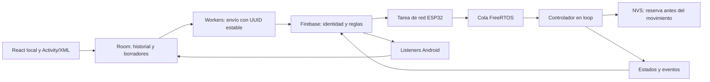

# Guía de Firebase para Pastillero Badi

## Actualización V2 que debe leerse primero

El contrato vigente incorpora `devices/pastillero-01/v2`: program, state, commandRequests, commandResults y events. V1 se mantiene independiente para compatibilidad; el ejemplo histórico de las secciones siguientes explica esas rutas anteriores. El programa V2 añade version=2, positions=5, settings, regimens y doses con medicationId. Los cuatro espacios de dosis son 1..4; cero queda vacío. Véase el ejemplo completo y permisos en `CONTRATO_FIREBASE.md` y el recorrido en `VERSION_2_IMPLEMENTACION.md`.

Las reglas V2 se publicaron con confirmación del responsable en PastilleroBadi. Exigen las mismas cuentas vinculadas, enabled y sesión posterior a revokedAt; no añaden acceso público ni privilegios de administrador. Solo el responsable escribe program/commandRequests, y solo el dispositivo escribe state/events/commandResults. Las 37 pruebas de reglas son locales; los sondeos y SDK reales se registran por separado en RESULTADOS.md. Una compilación no demuestra una conexión ESP32 real.

## 1. Qué almacena cada parte

Firebase Realtime Database es el árbol JSON compartido por Android y ESP32. Room es la base SQLite del teléfono; NVS es la memoria persistente del ESP32. Una caída de Internet no convierte estas tres copias en una sola base: las colas, identificadores y acuses permiten reconciliarlas después.



El diagrama indica responsabilidades; no significa que se hayan ejecutado pruebas físicas. La tarea de red puede esperar HTTP sin detener el avance del motor en el otro hilo. Room mantiene las filas aunque la pantalla se cierre.

## 2. Proyecto y archivos

| Dato | Valor público |
|---|---|
| Proyecto | PastilleroBadi |
| ID | `pastillerobadi` |
| Realtime Database | `https://pastillerobadi-default-rtdb.firebaseio.com` |
| Paquete Android | `mx.edu.badi.pastillero` |
| Dispositivo configurado | `pastillero-01` |
| Contrato | `CONTRATO_FIREBASE.md`, versión 4; programa V2 separado |
| Reglas | `firebase/database.rules.json` |
| Pruebas locales | `firebase/rules.test.mjs` |
| Configuración pública local | `app/google-services.json` |
| Configuración privada de pruebas | `private/integration.local.properties`, sin reproducir sus valores |

CRUDSQLITE1 se utilizó como referencia de lectura y permanece independiente. Sus permisos de base no se trasladaron a Badi. No se creó facturación para este trabajo.

## 3. Autenticación frente a autorización

Authentication responde «¿qué cuenta inició sesión?». Las reglas responden «¿qué operaciones puede realizar esa cuenta?». Un correo/contraseña válido entrega una sesión, pero no concede por sí mismo acceso a un pastillero.

Hay dos cuentas ordinarias distintas: responsable en Android y dispositivo en ESP32. No necesitan ser cuentas de Google del navegador. Registrar un identificador con formato de correo en Authentication no crea un buzón Gmail ni acredita su propiedad. Un buzón inexistente no podrá recibir recuperación/verificación de correo.

Android obtiene la sesión con `signInWithEmailAndPassword()`. El firmware usa la API REST de Authentication y renueva su sesión desde la tarea de red. Las contraseñas y tokens no se escriben en esta guía. La clave pública de configuración del cliente no es una cuenta de servicio ni una contraseña administrativa.

El futuro dashboard requiere otra cuenta, principal e independiente, con autoridad comprobada en un backend confiable. Las reglas de clientes no permiten que Android, ESP32 o una página cualquiera se conviertan en administrador. Véase `ADMINISTRACION_WEB.md`; ese backend y su prueba local están preparados, pero su activación privilegiada y frontend administrativo siguen pendientes; React móvil ya está implementado.

## 4. Árbol de datos

Los nombres `UID_RESPONSABLE`, `UID_DISPOSITIVO`, `dosis-ejemplo-a` y `comando-ejemplo-a` siguientes son marcadores didácticos, no credenciales. En ejecución se usan los UID y UUID reales. Las fechas son ejemplos, no un horario que se importe o ejecute.

```json
{
  "access": {
    "users": {
      "UID_RESPONSABLE": {"role":"owner","enabled":true,"revokedAt":0,"version":1},
      "UID_DISPOSITIVO": {"role":"device","enabled":true,"revokedAt":0,"version":1}
    }
  },
  "devices": {
    "pastillero-01": {
      "ownerUid":"UID_RESPONSABLE",
      "deviceUid":"UID_DISPOSITIVO",
      "plan": {
        "revision":1,
        "token":"borrador-ejemplo-a",
        "targetMode":"simulation",
        "doses":{"dosis-ejemplo-a":{"scheduledAt":1800000000000,"compartment":1}}
      },
      "state": {
        "phase":0,"calibrated":false,"appliedRevision":0,
        "updatedAt":1799999900000,"simulation":true,
        "storageHealthy":true,"blisterPresent":true
      },
      "commandRequests": {
        "comando-ejemplo-a":{
          "type":"PING","requestedBy":"UID_RESPONSABLE",
          "requestedAt":1799999900000,"expiresAt":1800000500000,
          "targetMode":"simulation","planRevision":0
        }
      },
      "commandResults": {
        "simulation": {
          "comando-ejemplo-a":{
            "status":"COMPLETED","reason":"OK",
            "requestedAt":1799999900000,"executedAt":1799999901000,
            "planRevision":0,"simulation":true
          }
        }
      },
      "events": {
        "dosis-ejemplo-a-SIM-MISSED":{
          "doseId":"dosis-ejemplo-a","type":"MISSED","scheduledAt":1800000000000,
          "actualAt":1800000300000,"compartment":1,"simulation":true
        }
      }
    }
  }
}
```

| Ruta | Quién la modifica | Cómo se utiliza |
|---|---|---|
| `/access/users/<uid>` | Backend administrativo o consola | Habilitación y corte de sesiones; el usuario solo puede leer su registro propio |
| `/devices/<id>/ownerUid`, `deviceUid` | Aprovisionamiento administrativo | Vinculan las cuentas; los clientes no pueden reescribir el vínculo |
| `plan` | Responsable vinculado y habilitado | Publica un plan con revisión creciente y token de borrador |
| `state` | Dispositivo vinculado y habilitado | Informa revisión aplicada, fase y antigüedad |
| `commandRequests/<uuid>` | Responsable | Solicita PING o comprobación APPLY_PLAN; nunca una confirmación física |
| `commandResults/<modo>/<uuid>` | Dispositivo | Responde al comando correspondiente y al modo correcto |
| `events/<clave>` | Dispositivo | Publica STARTED, CONFIRMED, MISSED, BLOCKED o RECOVERY |
| `/administration` | Backend administrativo o consola | Información administrativa/auditoría; inaccesible a cuentas ordinarias |

## 5. Cómo viaja un horario

1. La persona elige fecha, hora y compartimento en Android. El selector usa la zona del teléfono y guarda milisegundos UTC.
2. `Repository` valida y guarda un `PlanDraft` en Room con `dirty=true`, `baseRevision` y un UUID nuevo para esa edición.
3. `SyncWorker` espera conectividad y abre una transacción sobre `plan`.
4. Si la revisión remota cambió, no sobrescribe silenciosamente: marca conflicto. Si el mismo token ya se confirmó antes de un reinicio, reconoce ese acuse sin duplicar la edición.
5. Firebase confirma la escritura; Room limpia `dirty` únicamente si todavía coincide el token enviado. Se encola APPLY_PLAN con identidad estable.
6. La tarea Firebase del ESP32 lee el plan y lo encola. `loop()` solo lo aplica estando estacionario y tras verificarlo completo.
7. NVS conserva el plan antes de que pase a ser programación activa. `state.appliedRevision` comunica la aceptación real del firmware.
8. A la hora programada, el controlador exige calibración, presencia de blíster y almacenamiento sano. Reserva STARTED antes del primer movimiento.
9. Regresa a cero y espera una nueva pulsación del botón. El evento CONFIRMED se almacena primero en NVS y se publica después.
10. Android inserta el evento con clave única en Room y muestra hora prevista, hora registrada y diferencia.

«Sincronizado» describe el acuse del plan; «aplicado» describe la aceptación del dispositivo; «confirmado» describe el evento del botón. Ninguno sustituye a los demás. El botón registra una declaración física de confirmación; no es un sensor que demuestre ingestión.

## 6. Condiciones e inmutabilidad

Las reglas vigentes deniegan por defecto. Para acceder al dispositivo exigen sesión autenticada, UID vinculado, cuenta habilitada y `auth_time > revokedAt`. `auth_time` y `revokedAt` están en segundos; dosis y eventos usan milisegundos. Confundir ambas unidades rompería la revocación o los horarios.

Las escrituras de plan requieren revisión siguiente y forma válida. Un ID de dosis ya publicado conserva su hora y compartimento: para una dosis distinta se usa otro ID. Las reglas de eventos/resultados admiten reintentos idénticos pero rechazan cambio o borrado. El propietario de Android no puede fabricar una confirmación.

El límite de 24 dosis y separación de diez minutos se comprueba en Android y firmware. Las reglas no comparan todos los pares ni cuentan todos los horarios: un cliente alterado podría intentar un plan que el firmware rechazará. Por eso hay validación en ambos extremos y se observa `appliedRevision`.

Cambiar de simulation a hardware requiere retirar previamente los horarios del plan anterior. Un firmware físico no reutiliza un plan simulado. Los resultados se separan por modo y las claves de eventos simulados incorporan `-SIM-`.

## 7. Reconexión y duplicados

| Problema | Respuesta implementada |
|---|---|
| Se perdió el acuse del plan | Token y revisión reconocen si esa misma edición ya quedó confirmada |
| Worker se ejecuta de nuevo | Usa el UUID y contenido guardados en Room, no crea otra solicitud |
| Se repite un evento | Firebase acepta copia idéntica; Room IGNORE evita otra fila/notificación |
| Wi-Fi se pierde | Reconexión ESP32 con espera creciente de 5 a 60 segundos; el control local no depende de cada petición HTTP |
| HTTP se demora | Tarea separada con tiempos límite y cuerpo de respuesta limitado |
| Se reinicia ESP32 durante una entrega | Reserva persistente y RECOVERY; no repite automáticamente la dosis |
| Se bloquea una cuenta | Reglas cierran acceso y Android cancela sincronización al observarlo; no borra Room |
| Se restablece una cuenta bloqueada | Requiere nueva sesión posterior al corte; no revive la sesión antigua |

No se garantiza reconexión real por haber probado `goOffline()/goOnline()` del SDK: eso no corta la radio ni ejecuta firmware sobre el ESP32. La reserva local tiene capacidad limitada; al agotarse o fallar la escritura se bloquean nuevas entregas para revisión.

## 8. Comandos y alertas

PING observa comunicación. APPLY_PLAN espera a que la revisión solicitada esté aplicada. Ninguno contiene una orden remota de dispensar o confirmar. Tienen UUID, solicitante, creación, caducidad máxima de diez minutos y modo. Un comando inválido, caducado o con revisión incompatible se rechaza; el otro modo lo deja para su destinatario.

MISSED ocurre tras cinco minutos desde la hora programada. BLOCKED identifica ausencia de blíster al intentar iniciar. RECOVERY identifica reinicio de una entrega reservada. Estos eventos comparten `events`; no se mantienen copias separadas de alertas e historial que puedan contradecirse.

Los avisos Android se producen al recibir eventos mediante el repositorio. No hay todavía FCM ni recepción garantizada con la aplicación cerrada. Las alertas físicas y el comportamiento de sensores requieren pruebas posteriores. La credencial del dispositivo autentica ese rol, pero no es una atestación criptográfica de hardware.

## 9. Dónde estudiar el código y comprobar resultados

`GUIA_ARDUINO_LINEA_POR_LINEA.md` recorre `mantenerSesionFirebase`, `sincronizarConFirebase`, `procesarMensajesDeRed` y la persistencia. `GUIA_ANDROID_LINEA_POR_LINEA.md` recorre `PastilleroApp`, `Repository`, `SyncWorker`, `CommandWorker`, reglas y pruebas. Sus tablas tienen los números finales de línea.

El informe vigente es `RESULTADOS.md`. La comparación de los 74 casos anteriores distingue pruebas locales, REST real, SDK Android real y pendientes físicos. Las reglas remotas no se cambian para documentar el proyecto: se compara su archivo con la huella que quedó publicada.

Referencia de sintaxis de autorización: [condiciones de reglas Realtime Database](https://firebase.google.com/docs/database/security/rules-conditions). La explicación de cada ruta y flujo anterior describe específicamente el código Badi.

## Integración local añadida

INTEGRACION_SOFTWARE.md recorre doce pruebas conectadas de ScheduleEngine (JVM), reglas Firebase locales, Controller del .ino y registro JSON compartido, más seis regresiones de propiedad de cadenas/reservas. Se corrigió la referencia a arreglos const que podía cambiar eventos o IDs reservados al reutilizar la dosis activa. writeDoseEvent/reserveDoseId fuerzan copias con longitud real; los casos verifican varias dosis y restauración del documento. El total acumulado queda en 192, con 27 casos añadidos al cierre de 165. No equivale a ejecutar UI/WorkManager ni ESP32 físico; no cambian las reglas publicadas o el contrato de datos.

La persistencia ESP32 se corrigió además a blobs NVS: snapshot-v2 + marcador snapshot-ver, límite local de 48000 bytes y lectura compatible de la cadena histórica. No se usa putString para documentos grandes ni se vuelve a una copia antigua si falta el bloque marcado. Ocho pruebas nuevas verifican estas funciones compartidas con un doble RAM, incluido un programa de 96 dosis mayor de 4000 bytes; la flash física, cortes de energía y RECOVERY del adaptador Arduino no se ejecutaron. INTEGRACION_SOFTWARE.md detalla la migración conservadora y sus límites.


Revisión del 22 de octubre de 2026: la configuración y los certificados están dentro del .ino; los datos locales se materializan mediante generate_private_firmware.py. La carpeta del sketch contiene solo .ino y partitions.csv. Referencia elegida, procedimiento privado y evidencia: COMPARACION_CRUDSQLITE1.md y UNIFICACION_FIRMWARE.md.
