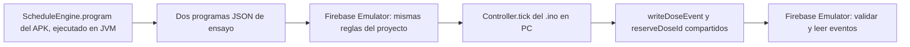

# Integración local del contrato: Java → Firebase → controlador C++

Este procedimiento amplía las pruebas de PastilleroBadi 2.0 sin usar hardware ni escribir horarios en Firebase de producción. El motor principal sigue siendo NEMA 17/TB6600; los destinos capturados por el adaptador de PC son números, no pulsos eléctricos.

## Qué se ejecuta realmente

`ContractFixtureTest` usa las entidades y `ScheduleEngine` reales de Android. Genera cuatro pautas independientes por intervalo, compartimentos 1..4, cinco espacios totales y ocho ocurrencias por programa. `contract.integration.test.mjs` lee esos JSON, accede como responsable/dispositivo ficticios al emulador y ejecuta `tests/contract_controller.cpp`.

El adaptador C++ define PASTILLERO_HOST_TEST e incluye directamente PastilleroESP32.ino, la misma implementación del controlador. Usa ArduinoJson 7.3.2 instalado en el proyecto y las funciones compartidas de escritura/reserva. `Port` captura movimientos y guarda reservas en un documento JSON. No incorpora AccelStepper, Arduino, sensores, Wi-Fi ni puertos serie. Las señales de botón/salida y el tiempo de ejecución son entradas de prueba.

Esto **no ejecuta DashboardActivity, WorkManager ni el runtime de red/NVS del ESP32**. Las pruebas de puente nativo/Room y SDK real previas están separadas en RESULTADOS.md. No equivale a una prueba física completa Android→ESP32.

## Programa futuro y caché anterior son casos distintos

La fixture futura se publica con las reglas activas y se lee como dispositivo. Un plan nuevo con fechas vencidas debe ser rechazado; se comprueba ese rechazo.

La fixture cacheada representa un plan aceptado antes de perder conexión. Solo se coloca como semilla del emulador con `withSecurityRulesDisabled`. Esto permite ejecutar los estados con fechas virtuales anteriores al instante actual, sin esperar minutos reales ni cambiar el reloj del equipo. **No se presenta esa siembra como una publicación nueva aceptada por las reglas.** Después de sembrar, lecturas, escrituras de eventos, reintentos, conflictos y revocación usan cuentas ficticias sujetas a las reglas normales.

El proyecto está fijado a `demo-pastillero`, host 127.0.0.1 y puerto 9009. El script exige FIREBASE_DATABASE_EMULATOR_HOST exacto y no carga credenciales privadas. El emulador se inicia y cierra mediante Firebase CLI.

## Error encontrado y corregido

La primera corrida integrada aprobó seis casos y rechazó seis escrituras de eventos. Las reglas actuaron correctamente: la clave del evento no coincidía con el doseId que contenía el JSON.

En ArduinoJson 7.3.2, `const char (&)[N]` se adapta como cadena estática. Al pasar `d.id` y `d.medicationId` desde `const Dose&`, el documento conservaba referencias a los arreglos de la dosis activa. Al reutilizar esa estructura para otra dosis, podían cambiar eventos anteriores. La clave de `done[d.id]` estaba expuesta al mismo problema, afectando las reservas contra duplicados. Un identificador corto también debe conservar su longitud real.

Se añadieron dos funciones compartidas dentro del `.ino`:

| Función | Efecto |
|---|---|
| `pill::writeDoseEvent()` | Convierte los arreglos a const char* antes de asignar, seleccionando la copia con longitud real en la biblioteca fijada. Conserva doseId, medicationId, tipo, fechas, compartimento y modo. |
| `pill::reserveDoseId()` | Hace la misma conversión para la clave reservada. La siguiente dosis no puede renombrar una reserva anterior. |

`AdaptadorMotor.record()` usa ambas antes de persistir. El adaptador de integración también llama esas funciones; la prueba no mantiene otra implementación del serializador o de la reserva. Los formatos JSON y las reglas Firebase permanecen iguales.

La política se verificó en la dependencia local: `toolchain/libraries/ArduinoJson-7.3.2/src/ArduinoJson/Strings/Adapters/RamString.hpp` y `Strings/StringAdapter.hpp`. No se presupone que todas las formas de asignar una cadena tengan la misma propiedad de memoria.

## Persistencia: cadenas anteriores y bloques nuevos

La revisión posterior encontró otro límite concreto: NVS admite cadenas de hasta **4000 bytes incluyendo el terminador**, mientras que el firmware permite una instantánea de hasta 48000 bytes. Un programa válido con muchas dosis podía superar el límite de `putString`. [La documentación de Espressif distingue los límites de cadenas y blobs](https://docs.espressif.com/projects/esp-idf/en/latest/esp32/api-reference/storage/nvs_flash.html).

`guardarEstadoPersistente()` usa ahora `pill::saveSnapshotBlob()`: escribe los bytes JSON en `snapshot-v2` con `Preferences.putBytes` y confirma `snapshot-ver=2`. Solo acepta éxito si ambos retornos son completos. Se conserva la partición NVS existente de 256 KiB; no se modifica el mapa de flash ni se carga firmware.

`snapshotSource()` da prioridad al bloque nuevo. Si existe el marcador pero falta el bloque, no recupera automáticamente una cadena antigua que podría olvidar una dosis reservada. Un bloque vacío, excesivo, incompleto, con cero interno o JSON inválido deja el controlador en Fault. La lectura requiere memoria para todos los bytes y el terminador. El fallo no se normaliza sobrescribiéndolo con una instantánea vacía.

La clave histórica `snapshot` se puede leer y migrar una vez; queda conservada como copia recuperable. Un protocolo V1 guarda su copia en `legacy-v1b` mediante bytes antes de retirar únicamente el plan incompatible. No se borran `done`, eventos ni copias antiguas `legacy-v1`. Las áreas de simulación y hardware siguen separadas. La recuperación de una entrega activa conserva también medicationId cuando existe; una copia V1 puede carecer de ese campo.

`tests/snapshot_test.cpp` usa las mismas funciones plantilla que el adaptador real y un almacén en RAM con retornos de error controlados. Sus ocho casos comprueban: JSON de 96 dosis mayor de 4000 bytes con reservas/eventos; rechazo de tamaño/nulo/vacío; escritura corta; fallo del marcador; selección de formato anterior/nuevo; bloque inválido o lectura corta sin fallback; cero interno; capacidad del terminador sin desbordamiento. **No prueba cortes de alimentación, desgaste, atomicidad de NVS ni memoria disponible en un ESP32 real.** El análisis de JSON inválido y RECOVERY siguen en el adaptador Arduino; no se presentan como ejecutados por este doble.

## Casos nuevos

| Grupo | Casos y evidencia |
|---|---|
| JVM | Una prueba produce programas mediante ScheduleEngine real; se suma a las 31 anteriores. |
| JSON compartido, PC | Seis casos: eventos independientes después de reutilizar arreglos; identificadores cortos/temporales; medicationId vacío de recuperación V1; serialización de evento/active; reservas independientes; reservas después de serializar/restaurar. `reports/event-json-tests.log`. |
| Instantáneas, PC | Ocho casos del contrato de almacenamiento compartido con un doble RAM; `reports/snapshot-tests.log`. |
| Integración, emulador | Doce casos descritos abajo, `reports/integration-v2-contract.log`. |

1. Programa futuro Java autorizado para el responsable, rechazado para el dispositivo; rechazo del nuevo plan vencido y espera de dosis aún no debidas.
2. Cuatro entregas simuladas con regreso al cero y cuatro confirmaciones, con eventos legibles por el responsable.
3. Omisión después de cinco minutos, sin movimiento.
4. Falta de blíster: BLOCKED, sin confirmación ni movimiento.
5. Sin salida detectada: regreso a cero, NO_EXIT y ninguna confirmación.
6. Repetir plan/eventos conserva identidades y no solicita movimientos nuevos.
7. Reiniciar el modelo con STARTED reservado omite esa dosis: se conservan cuatro STARTED y solo tres CONFIRMED; no se inventa RECOVERY ni la confirmación de la entrega interrumpida.
8. Fallo de la reserva: Fault antes del primer movimiento.
9. Reloj inválido o falta de calibración: ninguna entrega nueva.
10. El ejecutable de QA rechaza targetMode=hardware.
11. Una escritura offline obsoleta no reemplaza la revisión ganadora remota.
12. Revocar al dispositivo deniega su sesión anterior y conserva el acceso del responsable.

Las capturas de destinos confirman 640, 1280, 1920 y 2560 pasos para cinco espacios y 3200 pasos/vuelta; cada destino vuelve a cero. Cuando las cuatro dosis tienen la misma fecha, su orden depende de la clave recibida y de la selección del controlador. Esto no cambia la secuencia manual `s`, que recorre 1→0,2→0,3→0,4→0 en orden.

## Cómo repetir

Desde `C:\Users\milit\AndroidStudioProjects\PastilleroBadi` ejecutar `tools/validate-integration.ps1`. El compilador de PC está en `toolchain/zig/zig.exe`; no depende de la carpeta de otro proyecto. La herramienta compila el adaptador y pruebas JSON, conserva las pruebas anteriores del controlador, regenera fixtures Java recientes y lanza Firebase Emulator. Compara huellas de fuentes antes/después para rechazar una corrida si se editaron durante QA.

Las variantes ESP32 se compilan por separado mediante `tools/validate-firmware.ps1`. Ahora selecciona DRY_RUN=0/1 con una opción del compilador: **el .ino permanece en 1 durante toda la operación**, incluso si se interrumpe. No hay carga de firmware ni monitor serie.

Resultados y límites de la corrida final: `reports/integration-v2-validation.log`, `integration-v2-source-hashes.json`, `integration-v2-receipts.json` y RESULTADOS.md. Se conserva la corrida inicial fallida en `reports/integration-v2-initial-failure.log` como evidencia del defecto detectado. Los valores de prueba son ficticios y no contienen contraseñas ni tokens reales.

Revisión del 22 de octubre de 2026: la configuración y los certificados están dentro del .ino; los datos locales se materializan mediante generate_private_firmware.py. La carpeta del sketch contiene solo .ino y partitions.csv. Referencia elegida, procedimiento privado y evidencia: COMPARACION_CRUDSQLITE1.md y UNIFICACION_FIRMWARE.md.
