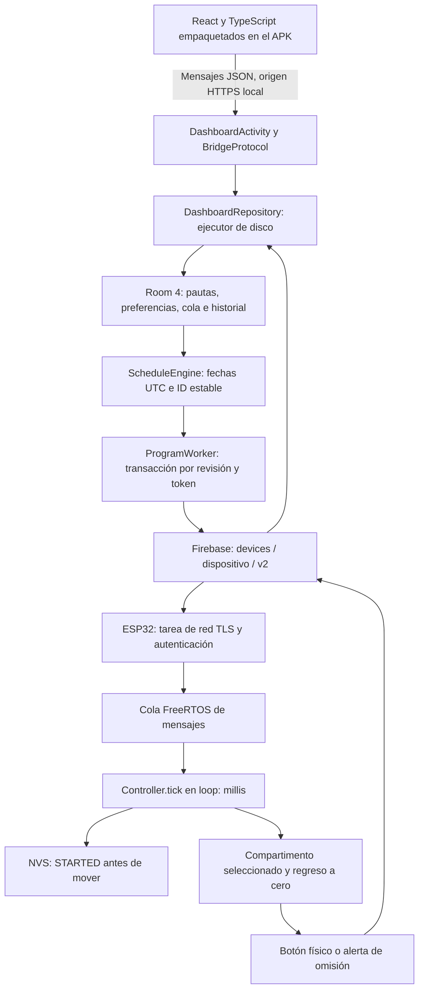

# PastilleroBadi 2.0: implementación y recorrido para estudiar

Raíz única: `C:\Users\milit\AndroidStudioProjects\PastilleroBadi`. La auditoría de los dieciséis requisitos está en `AUDITORIA_VERSION_2.md`; el estado verificable está en `RESULTADOS.md`. El respaldo previo se identifica en `reports/version2-backup.json`.

## Arquitectura que ejecuta el código

El diagrama describe la implementación, no una prueba física realizada. Java conserva la autoridad de autenticación, validación, Room y Firebase. React recibe únicamente instantáneas de datos de pantalla. El navegador de demostración usa `preview.ts` y localStorage: no se presenta como una conexión Firebase.

## Frontend y seguridad del puente

`web/src/App.tsx` contiene Inicio, Calendario, Medicamentos, Historial y Ajustes. `tokens.css` cambia el tema claro/oscuro; `styles.css` implementa superficies translúcidas, foco, disposición adaptable y respeto de movimiento reducido. Los iconos son SVG propios. No se descargan fuentes ni scripts de terceros al abrir la app.

`DashboardActivity` sirve los recursos mediante WebViewAssetLoader desde `https://appassets.androidplatform.net/assets/dashboard/index.html`. Rechaza navegación/red ajenas a su origen y directorio; prohíbe file/content y contenido mixto. Usa WebViewCompat con un único origen y comprueba además el marco principal. No hay `addJavascriptInterface`. Un WebView antiguo muestra la vista clásica de compatibilidad; no recibe un puente menos seguro.

`BridgeProtocol` exige versión, ID y acciones permitidas, máximo 32768 caracteres, campos conocidos y tipos exactos. Acciones: snapshot, saveMedication, deleteMedication, savePreferences, publish, retry, reload, rebase, ping, signIn, signOut y nativeView. No existen DISPENSE ni CONFIRM remotos. La autenticación abre campos nativos; ninguna contraseña cruza hacia React. El botón Atrás cierra un diálogo antes de abandonar la vista.

## Calendario y pautas independientes

Una pauta tiene UUID, nombre, zona IANA, compartimento 1..4, vigencia y modo. En modo diario admite de una a seis horas HH:mm distintas. En modo intervalo admite de quince minutos a siete días, anclados a su propio inicio. Dos medicamentos pueden coincidir: el controlador los atiende uno por uno, sin iniciar dos movimientos simultáneos.

`ScheduleEngine.expand()` es la autoridad nativa. Convierte horas locales a instantes UTC. Omite horas inexistentes por cambio estacional y resuelve una hora ambigua una sola vez. El ID deriva de pauta, instante y compartimento: recalcular/reintentar no crea otra dosis; cambiar el compartimento genera una ocurrencia diferente. El calendario muestra fechas reales de lunes a domingo y conserva la semana seleccionada durante una edición.

Programar es explícito: «Publicar programación» prepara desde dos minutos después del instante actual, con ventana de uno a siete días y máximo 96 ocurrencias. Exceder la capacidad devuelve error; no se cortan silenciosamente las dosis. Las recurrencias no se renuevan indefinidamente en el ESP32: hay que revisar y publicar otra ventana antes de agotarla. La pantalla «Sin registro» no inventa una omisión; MISSED requiere un evento del dispositivo.

## Room, publicación y conflictos

Room 4 conserva `dose_events`, `plan_drafts` y `command_requests`; añade `medications`, `device_preferences` y `program_outbox`. Agrega medicationId al historial y protocolVersion a solicitudes con valores predeterminados para filas antiguas. Las migraciones 1→2→3→4 son aditivas; no se borra el historial. V1 y V2 mantienen sus borradores y rutas separados.

Guardar una pauta marca `edited`; publicar genera JSON/token y marca `dirty`. WorkManager espera red y reintenta con el mismo token. La transacción solo avanza desde la revisión base esperada. Si otro editor cambió la nube, se informa conflicto. «Traer pautas remotas» reemplaza las definiciones locales por elección explícita. «Conservar pautas locales» actualiza la revisión base y exige revisar/publicar; ninguna opción borra eventos históricos. Un acuse de una edición antigua no limpia una edición posterior porque el UPDATE compara token.

Al revocar una cuenta, las reglas deniegan el acceso y el repositorio retira listeners/cancela trabajos observados. El historial ya descargado permanece local. Room no almacena las contraseñas y no está cifrado con SQLCipher; utiliza el aislamiento privado de Android y los respaldos automáticos deshabilitados.

## Cinco espacios y periféricos

La configuración de producción y Android inicia en **cinco espacios totales**: cero vacío y cuatro de dosis. Con 3200 pasos/vuelta los destinos son 640, 1280, 1920 y 2560 pasos. Siempre regresa a cero después de soltar una pastilla: `640→0, 1280→0, 1920→0, 2560→0`. Cambiar geometría requiere detenerse y recalibrar. El perfil de cuatro posiciones queda para compatibilidad y sus pruebas históricas; no es el montaje predeterminado V2.

Los comandos a/r/c/s se conservan. a/r ajustan diez pasos, c declara cero y s recorre los compartimentos útiles en orden, regresando tras cada uno. No hay búsqueda automática de cero mediante encoder/final de carrera.

`Feedback` calcula LED, buzzer, servo y bomba con millis. El servo solo abre durante Drop. La bomba opcional comienza tras una confirmación nueva y se detiene al vencer su duración o producirse alerta/fallo; no se dispara repetidamente por mantener un nivel de confirmación. `ExitDetector` filtra diez milisegundos y exige un flanco nuevo; un sensor inicialmente bloqueado no equivale a salida. Si se exige sensor y no hay pulso antes del retorno, se registra NO_EXIT y no se permite convertirlo en toma confirmada.

El LCD produce dos líneas de dieciséis caracteres con dispensación, espera, omisión, salida ausente y recuperación. Una tarea I2C separada escribe el cuadro PCF8574; no hace esperar al bucle de pasos. La disposición PCF8574 RS0/RW1/E2/BL3/D4..7 y dirección 0x27 deben verificarse con el módulo real. GPIO previstos: SDA21, SCL22, salida35, servo13 y bomba23. PUL25 y DIR26 se conservan.

LCD, sensor de salida, servo y bomba tienen disponibilidad local **0** por defecto en la sección4 de `PastilleroESP32.ino`; una preferencia remota no elimina ese bloqueo. DRY_RUN=1 impide GPIO físico. Compilar DRY_RUN=0 solo produce un binario: no lo carga. Los modelos y drivers están escritos/compilados, pero conexiones, tensiones, pulsos, flujo de agua y respuesta mecánica siguen pendientes físicos.

## Reinicios, desconexión y límites

Se persiste STARTED antes de solicitar movimiento; una entrega activa recuperada pasa a RECOVERY en lugar de repetirla. NVS conserva IDs, plan y eventos pendientes. La transición desde un snapshot V1 guarda una copia legacy-v1b como blob, conserva reservas y eventos y retira el plan incompatible. Cada arranque exige calibración y hora válida antes de programar.

La tarea de red gestiona Wi-Fi, autenticación/renovación y HTTPS aparte del motor. La pérdida de nube no borra Room/NVS. No se ha ejecutado todavía esta tarea sobre un ESP32 real ni se ha cortado su radio. La capacidad local es finita: snapshot 48000 bytes, hasta 256 IDs reservados y cola de eventos limitada; al llenarse se bloquea de forma segura y requiere mantenimiento. No se borran IDs automáticamente para seguir dispensando.

Las alertas locales Android requieren recibir el evento y contar con permiso de notificaciones. Esta entrega no ofrece FCM ni garantía de aviso con la aplicación cerrada. La interfaz móvil React no es el dashboard administrativo con privilegios: el backend administrativo conserva sus doce pruebas locales; la activación privilegiada y el frontend de administración están pendientes.

## Rutas de configuración

Todas parten de la raíz indicada arriba. `app/google-services.json` contiene la configuración pública registrada para mx.edu.badi.pastillero. `firebase-config.properties` permite ajustes locales de cliente/dispositivo/modo. `private/firmware.local.json` separa WIFI_SSID, WIFI_PASSWORD, FIREBASE_API_KEY, FIREBASE_HOST, DEVICE_EMAIL, DEVICE_PASSWORD y DEVICE_ID. `private/integration.local.properties` contiene las cuentas de prueba ordinarias. Están ignorados por Git y sus valores no se imprimen en documentación. Las credenciales Wi-Fi deben introducirse personalmente antes de la fase física.

Referencias técnicas: [mensajes WebViewCompat](https://developer.android.com/reference/androidx/webkit/WebViewCompat), [PWM LEDC de Espressif](https://docs.espressif.com/projects/arduino-esp32/en/latest/api/ledc.html), [PCF8574 de TI](https://www.ti.com/lit/ds/symlink/pcf8574.pdf). Estas API no sustituyen la validación del módulo físico instalado.

## Integración local añadida

INTEGRACION_SOFTWARE.md recorre doce pruebas conectadas de ScheduleEngine (JVM), reglas Firebase locales, Controller del .ino y registro JSON compartido, más seis regresiones de propiedad de cadenas/reservas. Se corrigió la referencia a arreglos const que podía cambiar eventos o IDs reservados al reutilizar la dosis activa. writeDoseEvent/reserveDoseId fuerzan copias con longitud real; los casos verifican varias dosis y restauración del documento. El total acumulado queda en 192, con 27 casos añadidos al cierre de 165. No equivale a ejecutar UI/WorkManager ni ESP32 físico; no cambian las reglas publicadas o el contrato de datos.

La persistencia ESP32 se corrigió además a blobs NVS: snapshot-v2 + marcador snapshot-ver, límite local de 48000 bytes y lectura compatible de la cadena histórica. No se usa putString para documentos grandes ni se vuelve a una copia antigua si falta el bloque marcado. Ocho pruebas nuevas verifican estas funciones compartidas con un doble RAM, incluido un programa de 96 dosis mayor de 4000 bytes; la flash física, cortes de energía y RECOVERY del adaptador Arduino no se ejecutaron. INTEGRACION_SOFTWARE.md detalla la migración conservadora y sus límites.

Revisión del 22 de octubre de 2026: la configuración y los certificados están dentro del .ino; los datos locales se materializan mediante generate_private_firmware.py. La carpeta del sketch contiene solo .ino y partitions.csv. Referencia elegida, procedimiento privado y evidencia: COMPARACION_CRUDSQLITE1.md y UNIFICACION_FIRMWARE.md.
